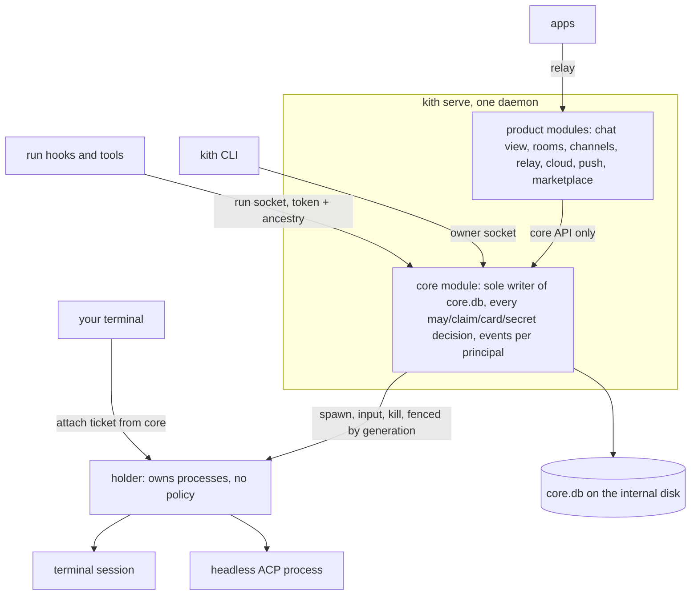

> **Source and links.** Copied unchanged from the architect's `designs/2026-11-03-runtime-shapes/design.md`
> (below the line). Page: <https://claude.ai/artifact/J7HAXmxMBD3pK9qDmRLWAT>. The TLA+ model (`Runtime.tla`,
> `results.md`) lives in the architect's `model/` folder next to `design.md`, not in this repo. This design
> supersedes [core-design.md](core-design.md) from A4 onward; the order of work is its section 7 (M0-M5), which
> replaced A4-A7 in [one-bot-model.md](one-bot-model.md).

---

# Kith core runtime: one daemon with the core inside, a holder below (v2)

Status: **agreed** v2 (Kai 2026-11-03: "Look great", on the proposed page v3), after two reviews (Opus: races and principals; Sonnet: operability) and TLC rounds 1 and 2 green (`## Verified`). Comparison A-E and Kai's answers:
runtime-shapes.html (artifact J7HAXmxMBD3pK9qDmRLWAT). Grounded in kith origin/main 0264e889, origin/rust-rebuild
fedfbb1a, herdrdev/herdr-core b63ecbd.

Kai's answers (decisions.md 2026-11-03): kith owns terminals but no session depends on one; the core holds
conversations; Windows matters now. Architect: adapt herdr's policy-free platform code, write the core fresh.

## What changed from v1, and why
- **One daemon, not core + host as two processes.** The host runs as the same OS user as the core, so it can open
  core.db and the owner token anyway (Opus review 15). A separate core process bought availability, not security,
  at the price of a Host principal, an internal API as big as the app API, and a hop on every chat. v2 keeps the
  boundary as a crate boundary inside one daemon (the core crate's internals are not importable; product code calls
  its API, never its tables) and keeps the option to split the process later if restarts hurt. This is close to
  shape B, minus B's rewrite of the product code.
- **The owner is never blocked by the core** (Kai's rule; Opus 5): core unreachable refuses guests and bots only.
- **Authority moves before conversations** (Opus 1, Sonnet 9): claims in the core before revoke and run tokens are
  there would leave revoke sweeping files nobody writes.
- **Fencing** (Opus 4): one core at a time by a lock held for life, generation kept in core.db.
- **Every start re-checks access in the same transaction** (Opus 8): a row-state CAS alone lets a claim made after
  a revoke start.
- **The terminal entrance keeps your environment, and has a direct fallback** (Sonnet 1, Opus 6).
- Placed what v1 dropped: the cloud sync lease, the resource gate, doors, waiters, account failover, the Mac link
  peer, warm ACP processes, the run socket with its ancestry check.

## 1. The shape

- **holder**: owns every agent process (PTYs and ACP pipes), pumps bytes, resizes, signals, reaps, keeps an output
  tail and unacked exits. Policy-free. Adapted from herdr's holder.
- **kith serve**: one always-on daemon. The core module owns core.db and every decision; product modules (today's
  host minus its turn runner, claims and run socket) sit beside it. On a machine with no app, the product modules are
  off and the daemon is just the core.
- **CLI**: one call per command, generated from the method table. Embedded mode: when no daemon answers, the CLI
  takes the core lock itself, runs the core in-process for that one command, and exits (headless, CI, the difftest
  sandboxes, a Mac before first setup). It never starts runs in embedded mode; it only reads and writes state.

## 2. State and who owns it

| State | Owner | Where |
|---|---|---|
| live processes, PTYs, output tails, unacked exits | holder | holder memory |
| conversations (record, claim, engine session pointer + hash, summary), wake queue, waiters, delegation and caps, children | core | core.db |
| people, members, bots, grants, connectors, run tokens, cards, revoke and suspended rows, the cloud sync lease, doors, access ledger, once-secrets metadata | core | core.db (+ OS secret store for values) |
| schedules and their run state, the cost ledger, the memory index, the resource gate (slots, parking) | core | core.db |
| account choice per run and failover (backup chain) | core, at start (bug 404e fix: the record names its account) | core.db |
| accounts state (what each account is doing: out until, usage readings, `last_started`; today `<machine>/accounts/state.json`, written by `kith-kernel`'s `record_started` and the Python account commands) | core, moves in at M2-M4 with the account choice | core.db |
| chat rows as shown, rooms, channel bindings, devices, relay keys, push tickets, Mac link transport | product modules | serve.db |
| role repos, agent.md, skills, memory notes | people and agents (files); the core indexes them | agents/ |

core.db and the binaries live on the internal disk (Sonnet 4); a spawn whose folder is on an unmounted volume returns
"agent folder not mounted" as a status, never a crash. A core that finds core.db missing where its marker says one
existed refuses to start empty (an empty db would read as "no grants"). On start: `quick_check` (the full `integrity_check` runs before a migration); before any
migration, a `VACUUM INTO` snapshot; `kith backup` includes a dump.

## 3. Principals

| Principal | Socket | Proof | May |
|---|---|---|---|
| Owner | owner socket (0700) | same OS user + local owner token | everything; never blocked by the core being down (section 6) |
| Run | run socket, the only one a guest sandbox may reach | run token minted at claim, bound to (agent, person, conversation, claim) AND the connecting peer's pid descends from the run's process (kept from runauth.rs:32-34); method subset as today's host.sock | that run's person on that agent; dies with the claim and with a revoke |
| Device / bot / peer | through the product modules | today's device keys, bot keys, Mac link pairing (api/peers.rs) | the person's, bot's or peer's limits, applied by the core: product modules pass the principal through, never the owner in its place |

Stated plainly (Opus 11): the daemon is the owner's process. A bug in a product module could reach core.db; the
crate boundary keeps honest code honest, not hostile code out. If that ever matters (hosted computers), the product
modules move into their own sandboxed process, and the API between them already exists.

Events are filtered by the core per principal (today's roles::event_for moves into the core), so no decision is
made outside it.

## 4. Conversations and writers

A conversation is a core record. One writer at a time (I11). The writer is a claim on (conversation), held by one
live turn:
- **Terminal entrance**: `kith <agent>` asks the core to open the conversation as a terminal session and sends its
  cwd and environment; the core filters the env (drops tokens and secrets), claims, asks the holder to spawn the
  engine's TUI with that env, and gives the CLI an attach ticket. Detach (default Ctrl+\, configurable) leaves it
  running. Size follows the last active viewer; observers never resize. A non-tty `kith <agent> | tee` runs headless.
- **Direct fallback**: `kith <agent> --direct` runs the engine in your terminal's own process tree, as today, with
  the writer claim taken from the core as an external writer (pid + start time) when the core answers, and a file
  claim when it doesn't (owner only). Used automatically when the holder can't be reached. It keeps TCC grants and
  IDE integrations that a launchd-started holder may not have (to test at M1 on this Mac's external disk).
- **Headless turns** (app, schedule, ask, wake): the core speaks ACP to the engine (it links kith-acp) over pipes the
  holder owns. One warm process may serve several sessions (today's turn.rs), so the claim is per conversation per
  turn: the core claims before each `session/prompt` and releases at turn end, not at process exit (Opus 7).
  The prompt's step `claimed -> running` (access re-checked) and the write to the pipe are one step against a revoke;
  if a revoke can land between them, the prompt reaches the engine with the kill right behind it (the same allowed
  window as step 6). A revoke also kills the person's idle warm processes (an idle one has no claim row, so nothing
  else would). A prompt that finds its process gone is reported as an exit, so the claim is released. Turn ends stay
  in the holder until a core acks them, like exits. (TLC round 2: tying the claim to process start instead sends a
  prompt after the revoke.)
- **Typed into a live terminal**: only when the message's principal equals the session's principal (same person,
  same run token scope); otherwise the message queues (Opus 3: a bot must not borrow its owner's terminal). The
  `[kith wake RUN]` marker rule stays, and the core reads the transcript live rather than only at exit, so a crash
  never redelivers an answered turn.
- **Transcripts**: the core stores a pointer and a hash per engine session (a Claude session is a directory, not one
  file). Before a start it places its copy only when the engine's copy is missing or unchanged since the last read;
  otherwise it adopts the engine's (Opus 14). Moving to another account copies it into that account's folder (gated
  on lab's test).

**Start protocol** (checked in the model):
1. Claim transaction: re-check may (person not revoked, agent granted, sync lease held for non-owners), take the
   claim (conversation, claim id, core generation), keep the turn queued. One transaction.
2. Then send `spawn(conv, claim, gen)` to the holder (record first, then start).
3. The holder spawns only for the newest generation it accepted; the first thing it runs is kith's start stub, which
   redeems the run token: a transaction that re-checks may and the lease again and moves the claim `claimed ->
   running`; only then the stub execs the engine. A revoke, stop or narrowing moves the same row to `ended` and asks
   the holder to kill.
4. Exits stay in the holder until a core acks them; the ack releases the claim and marks the turn done or requeues
   it in one transaction.
5. A new core (crash, update) takes the core lock, bumps the generation in core.db, says hello to the holder with
   the holder secret, and only then reconciles: release claims the holder doesn't list (requeue their turns), kill
   listed processes whose row is ended or that have no row, re-adopt the rest. Spawns from older generations are
   refused. **The core takes no claim until its reconcile has finished** (found by TLC: a claim taken while reconcile
   was between reading the holder's list and applying it got released under a running engine, and the next claim
   started a second writer, with no crash needed).
6. Claim ids come from a counter in core.db advanced inside the claim transaction, so a restarted core never reuses
   one. A revoke drops the person's queued turns. Between a revoke committing and its kill landing, the engine may
   still run tool calls that local rules allow without asking the core; the core refuses every ask from it, and any
   running core re-sends the kill until the holder reports the process gone (level-triggered, not once).

## 5. One API
One method table produces the CLI, the OpenRPC schema, the TS/Swift/Rust types, the docs; `released.json` frozen per
release, a test fails on any break. JSON-RPC lines on the sockets; framed mode with credit-based flow control for
attach and events (adapted from herdr's wire). Events carry sequence numbers and a `missed` reply. Card methods have a
CLI path (`kith cards ls|show|answer`), so a card raised while no app runs can be answered from a terminal; invites,
`kith link` and pairing say "needs the cloud" when it's unreachable (Sonnet 7).

## 6. Availability and fail-safe rules
- One core at a time: the core holds an exclusive lock on core.db for its whole life; the generation is a counter in
  core.db bumped under that lock and checked in **every transaction that touches claims** (claim, redeem, ack,
  reconcile apply), not only the claim; the holder requires the holder secret (Opus 4). TLC round 2: the lock alone
  holds; without it, checking the generation only at claim time lets a stale core's reconcile release the new core's
  claim under a running engine (second writer); checking it in all four holds even without the lock. So each layer
  covers the other's failure (a lost lock on a network disk, a bug in one transaction).
- The holder restarts a crashed core with backoff and a limit, then reports "core down" (no crash loop, Sonnet 3).
- Core unreachable: guest and bot runs refuse every decision; **owner runs proceed** under their own local rules,
  exactly as today when the host is down (only cards that need a human are refused) (Opus 5).
- Recovery verbs (`doctor`, `update`, `rollback`, `backup`, `restore`, `migrate`) work without a running core
  (embedded mode or plain files).
- Updates: a new daemon takes over and re-adopts the holder's processes; `kith update` asks before a holder update,
  since that ends live processes (their conversations stay).
- Version skew: the CLI, daemon and holder exchange versions in hello; an older CLI gets an update hint, never a
  silent fallback for state the daemon owns.

## 7. Order of work (revised)

| Step | What | Kai gets |
|---|---|---|
| M0 | daemon front for the core, holder skeleton, platform interface, method table, principals, embedded mode, fencing; Windows CI job from day one | the switched verbs through one API; a restart that keeps a test process |
| M1 | holder for terminals, opt-in: `kith <agent> --held`, still on today's claim files (no core.db claims yet) | terminals that survive closing the window, attach from anywhere, detach and come back |
| M2 | authority into the core: people, grants, run tokens on the run socket (ancestry kept), cards, revoke and suspended rows, the sync lease, doors and their sweep, the resource gate; auth.json replaced by a tombstone that makes old readers fail closed (Opus 12) | one place that decides; revoke-access, invitee-access, run-tokens, secret-cards re-run against it |
| M3 | conversations: claims and turns in core.db, transcripts held, wake queue and waiters, delegation and children, account choice and failover, per-turn claims on warm ACP processes; the host's turn runner and terminal claims deleted | the core holds every conversation; any account resumes; thread-writers re-run |
| M4 | schedules (one dialect, Q1), routines exported | one scheduler |
| M5 | the rest of the kernel in Rust, Python removed module by module; per-verb `KITH_CORE=python` rollback kept until here | no Python in the run path; Windows owner use once the hook commands are Rust |

## 8. Windows, now (corrected list, Sonnet 6)
Today's macOS-only pieces the core must replace, not just the platform layer:
- Writer claims have no Windows branch: `signal` is a no-op off Unix (claim.rs:251), liveness uses `ps -o lstart`,
  `pgrep`, `ps -A` (claim.rs, registry.rs, runauth.rs, lifecycle.rs).
- Every hook written into a run's settings is a bash or Python command (kernel/bin/kith:696-847): Windows owner use
  needs them as Rust commands, so they move early (with M2 and M3, the hot path anyway), not only in M5.
- Guard lists name `security` and `launchctl` (kith_guard.py:202-209); doors need `sandbox-exec` (kith_door.py:227).
- The Windows service today is a per-user Run key + supervisor (service/windows.rs), which is right: a session-0
  service could not own the user's ConPTYs. Keep it; adapt herdr's pieces inside it.
- No Windows release target yet (release.yml); the host already has portable-pty and a Windows-aware shell.rs.
- Guests are refused on Windows until it has a sandbox; owner runs work. Until M3, Windows keeps today's host turn
  path (split by OS, stated, not silent).

## 9. Invariants
- I11 one writer per conversation, across entrances, warm processes and core restarts.
- I14 one implementation per shared state: only the core writes core.db; old readers of moved files fail closed.
- I15 decisions only from the core: may, cards, secrets, event filtering; nothing caches an answer.
- I16 a run token dies with its claim and its person's revoke, and works only from inside its run.
- I17 product modules never widen: they pass the real principal; the core applies its limits.
- I18 the owner is never blocked by the core being down.
- Kept: I1-I10, I12, I13.

## 9b. Security: the database, code running as the owner, and keys
One daemon runs as the owner's OS user, so anything running as that user can open core.db; a process split would not
change that (the reason v2 merged core and host). What protects it:

Now (M0 for the files and boundary, M2 for the rest):
1. Guest sandboxes deny core.db, its WAL and shm files, the owner token and the owner socket; only the run socket is
   reachable. (The rule for invitee-access and run-tokens property suites, kept by coder.)
2. core.db joins the must-ask classes: reading it is `secret`, writing it is `trust`, so an owner run steered by a
   prompt injection must ask before touching it, as with auth.json today; it joins the protected-paths list.
3. State folder 0700, core.db 0600, refused at start if looser.
4. Only token hashes are stored; reading core.db never yields a usable token.
5. Tripwire: the core is the only writer, so it watches `PRAGMA data_version` for writes from any other connection
   and raises an owner card ("core.db was changed outside kith"), logging what changed.
6. The core crate's internals are not importable, and CI fails if product modules open core.db: the realistic risk in
   Rust is a logic bug that skips a check, and the boundary is what stops it.

Later, with a trigger each:
- Encrypt core.db (SQLCipher, key in the Keychain readable only by the signed daemon) for signed macOS release builds,
  once guests' conversations are common. It only protects on macOS: on Windows and Linux any same-user process can
  get the key. Backups then need the key.
- A separate sandboxed process, or better a separate OS user or VM per tenant, for the product modules: when hosted
  computers run other people's agents, or when the daemon starts parsing untrusted content in-process.

**Keys (agreed by Kai 2026-11-03: Codync's envelope):** after reading Codync's design (kith-app 4dbe1977,
docs/features/connector-credentials.md; today's host market/vault.rs), the recommendation is Codync's envelope: one
master key per machine in the OS store, readable only by the signed daemon (dev builds through `security`); secret
records encrypted with XChaCha20-Poly1305, the record name as associated data, in a local store (core.db on one
machine, a hand's own small store under brain and hands); no plaintext fallback; the same key later encrypts
core.db. It replaces the per-item text below, which is kept for the comparison.

**Keys (first version).** The OS store stays the only place values live: Keychain on macOS, Credential Manager on Windows, Secret
Service on Linux, behind one interface. No kith vault (its master key would sit in the same store; the host vault is
dropped in M2). The weak spot today: kith-auth writes items through `/usr/bin/security`, so each item trusts that
tool and, as understood, any program running as the owner can read it without a prompt (lab is testing this,
2026-11-03). Release builds therefore write and read items from the signed daemon through Security.framework, whose
access rule follows the developer signature across updates; dev builds and the harness keep `security`. Every item
is re-written once at M2. Values are never stored in core.db and never synced between hands; a new hand asks through
a Key card or receives a value once, encrypted to its pairing key. Bring-your-own vaults (1Password today, Bitwarden
later) are sources the core reads from. On Windows and Linux the store has no per-program access rule; there the
guard lists and the guest sandbox are the protection, and the docs say so. A hosted brain stores no user secret
values. This revises core-design.md section 8 ("always through security") for release builds.

## 10. Brain and hands: one crew across machines, and the hosted service
Kai (2026-11-03): "the same brain for later service, could be helpful as a hosted service". The core is the brain
(conversations, people and grants, cards, schedules, placement, memory index); a holder is a hand (runs agents where
the files and engines are). Three deployments of the same pieces:
1. One machine: brain and hand together (today, M0-M5).
2. A personal crew: the brain on an always-on machine; holders on the other machines dial in. Conversations live in
   one place (one writer, no cross-machine sync of them); the brain picks the hand per turn ("one crew, not machines").
   Between one owner's machines this replaces the Mac link; the peer link stays between different people's brains.
3. Hosted: Kith runs the brain; hands are the user's machines and hosted computers.

Required now so this stays cheap:
- The holder protocol works over a network from M0: per-hand pairing key, SSH or relay transport, reconnect and
  resume, generation fencing across machines.
- A hand that can't reach its brain for a lease period kills its guest and bot runs itself (a revoke must not be
  stranded on a cut-off hand); owner runs continue (I18). Lease expiry and the kill are one holder step (a later kill
  would be a window). While cut off, the hand refuses guests' redeems and asks and buffers its messages. Checked by
  TLC round 2 (a hand that keeps guest runs while cut off fails: a queued kill never arrives).
- Secret values never leave the hand: the brain holds grant metadata; values stay in each machine's secret store and
  are released only to that machine's runs.
Later, before a hosted brain: trust (a hosted brain sees conversations and decides grants in plaintext, unlike today's
ciphertext-only cloud; offer it as a choice or run it in the user's own cloud machine), hook latency over the internet
(measure; a cached answer needs a lease with expiry and its own model), brain failover (fencing between brains).

## 11. Open
- Default for messages to a live terminal session from the same person: type in or queue (designer).
- An idle warm ACP process for a conversation when a terminal turn arrives for it: kill it first, or keep it and
  forbid prompts while the terminal holds the claim (not modelled; decide at M3, model with it).
- Memory notes edited by parallel sessions: stay files, or writes go through the core.
- Whether a launchd-started holder can reach the external disk (TCC, Full Disk Access): test at M1; `--direct` is
  the fallback either way.

## Execution additions (main, 2026-11-03)
Kai: "you are welcome to make it finer to execute and check", then "when we are finishing and testing, we'll find those problems eventually". So these are short.

**Data import per milestone.** Each M that moves state into `core.db` ships `kith migrate` steps that are idempotent, take `--dry-run`, and take a `VACUUM INTO` snapshot first. They import from `auth.json`, `live/terminal/*`, `serve.db` people/grants/routines/vault, `kith-sched` jobs and the cost ledger. The check is a "same answer" run: every may, grant and claim question is asked of the old store and of `core.db` over a snapshot of real-shaped data, with zero differences before the tombstone. Restoring the snapshot undoes only a migration that failed or just finished. Once the core has answered anything after it, rollback is `kith rollback`, never a snapshot restore.

**The oracle after Python.** Difftest (Python vs Rust per CLI line) stops working once state lives only in `core.db` (M2+). Before each switch, freeze its cases as a golden corpus (inputs plus expected outputs) and keep running them against Rust. Trace checking: in a test mode the core emits claim, redeem, ack, reconcile and revoke events, and a checker replays them against `Runtime.tla`'s actions, so the model checks code, not only the design. `Runtime.tla` lives in the architect's design folder, not the repo; the architect drafts it as a verify skill and coder commits it, as with the other verify skills. The checked events (claim, redeem, ack, reconcile) exist only from M3. Each traced event is one committed transaction at the model's action grain, sent after the commit: a trace of steps the model treats as one but the code does in two would pass while the code is wrong (the revoke rows in #493).

**A delete list per milestone.** Name the host code each M removes, with a CI check that it is gone. M2: the decision parts of `api/roles.rs`, `runauth.rs`, `market/vault.rs`, the host people mirror and its 10-second `kith-auth` refresh, the host's copy of `person.agents`, the host's `setPersonAccess` and `decideAccessRequest`. M3: `terminal/claim.rs` and `registry.rs`, `agent/bot/turn` and `queue`, the threads claim files (and `kith-kernel`'s `threads` module, which M3 replaces).

**Branch sync and the way to main.** Merge `origin/main` into `rust-rebuild` before each M-step starts. Kai, 2026-11-03: `rust-rebuild` goes to main "after M0c is fine". When M0c is merged and `rust-rebuild` CI is green, the manager tells main, and Kai merges; managers never merge into main.

### M0 build rules
- **M0a:**
  - The lock is a separate `core.lock` file, which nothing ever deletes. The holder's pid and start time go in a second file, `core.holder` (written after the lock is taken, owner-only, in the same folder; on Windows a held lock covers all of core.lock, so nobody could read the line there), so `kith doctor` can end a holder that holds the lock but doesn't answer.
  - Every lock holder bumps the generation, embedded mode included.
  - Embedded mode never says hello to a holder and runs no claim transactions.
  - One function opens every transaction that touches claims and checks the generation.
  - Embedded mode may create a fresh core.db but never migrates an existing one. A binary that knows an older schema refuses to write.
  - Use WAL, and `BEGIN IMMEDIATE` for writes.
  - On Windows, the 0700/0600 check means an owner-only access list.
  - `quick_check` at daemon start, the full `integrity_check` before a migration (section 2).
  - Embedded calls skip `quick_check`; hooks will call embedded mode, so each call stays cheap.
- **M0c (check, added):** until M1, a missing or crashing holder stops neither `kith serve` nor the CLI, and the release bundles `kith-holder` or the daemon runs without it. (Once `rust-rebuild` reaches main, Kai's live `kith serve` will try to start `kith-holder` and nothing uses it until M1.)
- **M0d:**
  - Kill is idempotent, and a kill for an unknown id answers "gone".
  - Kill takes the whole process tree: one job object per spawn on Windows; own session plus `killpg` on Unix, reporting "gone" only once the group is empty.
  - The daemon starts the holder detached (own session on Unix, `CREATE_BREAKAWAY_FROM_JOB` on Windows).
  - The switch to "the holder restarts the core" lands at M1, together with the launchd change.
  - The survival test runs under the real launchd job and the real Windows supervisor.
- **M0f:** the core tags each process at spawn with "kill on lease loss". On expiry the holder kills the tagged processes in the same step and leaves owner processes alone.

### Architect's M0 answers (2026-11-03)
**Crates and binaries.** `core/runtime` is `kith-core`; it depends on `kith-kernel`, never the other way, and `kith-kernel` never learns where `core.db` is. `core/api` is `kith-api`: the method table in Rust (serde request and result types plus one row per method: name, params, result, allowed principals, CLI shape, stability), with OpenRPC, TS and Swift generated, checked in and diffed by CI; `released.json` is the OpenRPC snapshot cut at each release and the break test allows additions only. Product modules call the core in-process through this table with a principal; `kith-core` has no other public functions. `core/holder` is `kith-holder`, a separate binary that links neither crate (CI checks it), because Windows cannot overwrite a running exe. M0f runs SSH over stdio (`ssh host kith-holder --stdio`); the pairing key is checked inside the stream, and the local holder secret is the local hand's pairing key. No relay in M0.

**Access verbs after M2.** No per-verb Python rollback: the dispatcher refuses `KITH_CORE=python` for access verbs and points to `kith rollback`. With the daemon stopped and `core.lock` held, `kith rollback` exports `auth.json` from `core.db` once (revoked and suspended rows included) and marks `core.db` non-authoritative; it also writes every secret record back as its own OS-store item, in the shape kith-auth reads (at M2 the keys move into the envelope and kith-auth stops writing them, so an auth.json-only export would lose every key added or changed since); the new core refuses to start until `kith migrate` imports `auth.json` and those OS-store items back. Grants move as one block (I14). `revoke-access` gains the property "a rollback keeps every revoke and every key".

**The core-down list.** When the daemon is down the owner falls back to embedded mode (a full core), so there is no second rule set. This list applies only when no core can run at all (a silent lock holder, `core.db` missing or refused, a pending migration). Owner runs keep exactly five things: (1) the run's `settings.json` as last written, enforced by the engine; (2) the must-ask classes (I13), fixed in the kernel and compiled in, answered by the engine's own prompt, not a kith card; (3) the `--direct` file writer claim, owner only; (4) environment already given to a running run; (5) the recovery verbs: `doctor`, `update`, `rollback`, `backup`, `restore`, `migrate`. Everything else refuses with a status naming the recovery verb; nothing reads `core.db` outside a running core. Tests: one case per item, plus one showing a grant, card or secret call refuses.

## Verified
model: designs/2026-11-03-runtime-shapes/model/Runtime.tla · TLC v1.7.4 via tools/tlc.sh · bounds: 1 conversation,
2 turns alternating terminal/headless, 2 core crashes (gen 1-3), 4 claim ids · 2026-11-03 · round 1 (start protocol)

| Property | Result | Broken variant fails? |
|---|---|---|
| NoTwoWriters (I11) | pass, 3,593,035 states (re-run by architect, same count) | yes: holder accepts any generation (7,547); reconcile before hello (9,483); send before record (7,942, a reused claim id) |
| EveryProcessHasItsClaim (running, or ended awaiting its kill) | pass | yes: any generation (1,435, re-run by architect); reconcile before hello (1,221) |
| NoLostTurn, safety | pass | send-before-record does not lose turns (the turn is queued first), it breaks 1, 2 and 4 instead |
| NoLostTurn, liveness (weak fairness, 2 crashes) | pass, 15,413 states | non-vacuous: fails with 1 claim id |
| NothingStartsAfterRevoke | pass | yes: no start stub (268, re-run by architect); send before record (390) |
| DecisionsOnlyFromTheCore (I15, I17) | pass | yes: hook-side cache (703); revoked set loaded after serving (114, through the host path) |
| Kind switches only with no live process | pass | yes: send before record (227) |
| Two conversations, no crash | pass, 74,937 states | (with a crash: over 10 min, not finished) |

Found: the v1 protocol failed NoTwoWriters with no crash (claims during reconcile); fixed by step 5's rule.
Round 2 (v2 rules; each behind a flag, round-1 configs reproduce their exact counts) · 2026-11-03

| Property / config | Result | Broken variant fails? |
|---|---|---|
| Fencing: all v2 rules, two cores may overlap, properties 1-5 + kind rule, 2 crashes (v2-fencing) | pass, 2,360,239 states (6 min; re-run by architect, same count) | yes: no lock, generation checked only at claim (EveryProcessHasItsClaim, 11,098, re-run by architect; NoTwoWriters 96,130) |
| Fencing without the lock, generation checked in every claim transaction (1 crash) | pass, 239,141 states | (so either layer holds alone) |
| Warm processes, claim per conversation per turn, 1 crash (v2-warm) | pass, 795,617 states; warm reuse reachable (sanity, 1,629) | yes: claim tied to process start sends a prompt after the revoke (NothingStartsAfterRevoke, 1,748, re-run by architect) |
| Hand cut off from its brain: guest stops after revoke + lease; owner never killed by the lease (I18) (v2-lease) | pass, 30,330 states (re-run by architect, same) | yes: hand keeps guest runs while cut off (1,871, re-run by architect) |
| KillsLand: engines may run forever, only kills end them (v2-kill-liveness) | pass, 102,229 states | yes: kill sent once by the revoking core (re-run by architect: fails, 2,998 states at the violation; modeler's run reported 49,725) |
| TurnsGetDone with revoke on (dropped turns count as settled) (v2-liveness) | pass, 102,229 states | |

Not modelled in round 2: two conversations together with crashes in the warm and fencing runs, brain failover, more
than one hand, reordering beyond FIFO per sender, the cloud sync lease inside the claim transaction, bots.
Not modelled: holder crash, typing into a live session, transcripts, unrevoke, more than one guest, grants other than
revoke, lost or duplicated messages (late ones are modelled).
