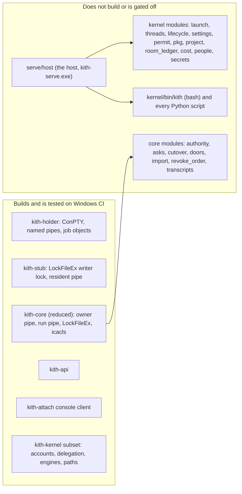
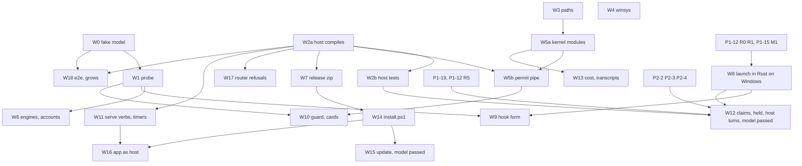

<!-- Source: architect design 2026-11-24-windows-owner (base bc28df057), brought into the repo as the plan that tracks the Windows owner milestone. -->
# Windows owner milestone: gap map and packages

Status: **agreed** (2026-11-24, architect) for the gap map, invariants and package order. Workers may start the
"start now" set (section 6). Some packages are marked **MODEL FIRST**, **REDESIGN** or **WAITS Pn-m**; none of
those gets a worker until its condition is met (the same rule as retire-python rule 7).
Asked by: flow manager windows-owner-plan, on Kai's word 2026-11-24: "I want windows to have the full functionality."
Base: origin/main bc28df057. Every file:line below is on that commit. I re-opened the blocker citations myself this call;
the rest come from three read-only sweeps run in the same hour against the same commit.
Read with: `docs/plans/retire-python.md` (P-items), `docs/plans/runtime-design.md` section 8, `docs/plans/one-bot-model.md` M5,
app plan v5 Phase 6h (K14, the GPU box OS).

Target: Windows 11 x64, owner path only. Guests on a Windows host stay refused (WI6; default for Q1, pending Kai's confirmation). Defaults for Q1-Q5 are pending Kai's confirmation;
see section 7 (2026-11-24).

## 0. Corrections to the brief

- **The desktop app is Electron, not Tauri.** `apps/desktop/package.json:44` (`electron ^44.5.1`), `:32` (`dist:win`),
  `apps/desktop/electron-builder.yml:1,109-129` (NSIS, x64, per-user). The plan keeps Electron.
- **CI runner: `windows-2025`, not Server 2022** (default for Q4, pending Kai's confirmation). Reason: Windows 11 24H2 and Server 2025 share one base
  (build 26100), so ConPTY, job objects and named pipes behave as they do on Kai's target. Today's job says
  `windows-latest` (`.github/workflows/ci.yml:766`). As far as I know (from memory, not checked this call) that label
  already resolves to 2025; the first run's "Runner Image" log line confirms it. Pin `windows-2025` and keep one
  `windows-2022` row in the nightly e2e only. Both are free: the repo is public (`ci.yml` procstart-macos comment).
- **"Windows works for invitees" is about the client only.** The host that `dist:win` bundles (`kith-serve.exe`,
  `electron-builder.yml:117-120`) is built by no CI job, and it cannot build on Windows today: `ci.yml:806-808`,
  `:1610`. So there is no Windows host yet, for owners or anyone else.

## 1. Where Windows stands (evidence)

- Windows CI builds and tests holder, core, api, the kernel subset, stub and attach (`ci.yml:763-812`). It has never compiled
  the host (`ci.yml:806-808`). One cause sits outside any cfg gate: `serve/host/src/runauth.rs:919-929`
  (`UnixListener`, `PermissionsExt`).
- Kernel modules gated to Unix: `core/kernel/src/lib.rs:6-44`. The Windows module list is
  `account-state, accounts, acp, delegation, engines, paths` (`lib.rs:76-84`).
- Core modules gated to Unix: `core/runtime/src/lib.rs:34-111`. On Windows, `terminal.open` answers "held terminals are not on
  this system yet" (`core/runtime/src/terminal.rs:701-705`), and `replay_open_removals` does nothing (`daemon.rs:198-200`).
- Every kernel verb the host does not own goes to bash. Off Unix that path refuses with "the kernel's commands run on macOS
  and Linux only" (`serve/host/src/kernel.rs:280-301`). `kith serve start|stop|restart|status` are kernel verbs
  (`kernel.rs:22`).
- Windows pieces that exist but are unused: the per-user Run key service and `kith-servew.exe` supervisor
  (`serve/host/src/service/windows.rs:1-150`, `src/bin/kith-servew.rs`); keep-awake through `SetThreadExecutionState`
  (`service/mod.rs` `KeepAwake`); PATHEXT and `.cmd` lookup (`agent/backends.rs:161-178`, `holder/src/platform/windows.rs:378-480`);
  the shell `cmd.exe /d /c` (`serve/host/src/shell.rs:33-52`).

## 2. Invariants (what must stay true; how each is checked is coder's call)

- **WI1. No silent no-op.** A Windows branch does the work or refuses with a named reason.
  - A bug on Windows today: channel Stop does nothing (`serve/host/src/channels/queue.rs:27-28`).
  - Not a bug (corrected 2026-11-24): the empty `end_groups` (`core/runtime/src/holder_link.rs:1085-1094`). Every holder
    spawn is in a job that kills on close and only the holder holds it (`core/holder/src/platform/windows.rs:632-634`), so
    the holder's death ends the tree. The empty body is correct only while that holds, and W12's model checks it
    (HolderKillOnClose).
- **WI2. Nothing kith itself starts on Windows is a script.** No `.py`, `.sh` or `.cmd` of kith's own, whether as a hook, the
  service, the host's subprocesses or the installer's helpers. Agents' own tools are theirs (retire-python section 4).
- **WI3. One hook form.** Every hook and status-line command kith writes is `"<absolute exe>" <args>`, with every argument in
  double quotes and no shell operators. The same line then works under cmd, PowerShell and Git Bash. Shell logic moves into
  the verbs.
- **WI4. Owner-only state.** core.db, the sockets/pipes, the secrets and the machine folder are readable by the owner, SYSTEM and
  Administrators only. This is checked natively, independent of locale, and kith refuses to start otherwise. It is today's
  rule (`core/runtime/src/perms.rs:1-6`) without `icacls` text parsing.
- **WI5. I11 holds on Windows: one writer per conversation.** The holder, the stub and the claims use LockFileEx and one job
  object per spawn. "Gone" means the job has no active process. Section 5.4 has the premise check.
- **WI6. Guests are refused on a Windows host, loudly,** until it has a sandbox (`runtime-design.md:240`). A guest launch must
  never fall through to an unsandboxed run.
- **WI7. A Windows owner run gets the Mac's settings,** except for the hook form (WI3) and how paths are spelled. A golden
  compares the two with paths normalised, so a rule added on one OS can't go missing on the other.

## 3. The shape (decisions)

- **D1. Layout.** Install per user, with no admin.
  - Programs go in `%LOCALAPPDATA%\Kith\cli\<version>\` (`bin\kith.exe`, `kith-holder.exe`, `kith-stub.exe`, `kith-servew.exe`,
    `share\kith\…` data).
  - State stays at `%USERPROFILE%\.kith` and agents at `%USERPROFILE%\kith\agents`, the Mac layout. Claude Code already keeps
    `%USERPROFILE%\.claude`, and one layout keeps the paths rules and package placeholders unchanged.
  - Not APPDATA: that would be a second layout that every rule then has to know.
- **D2. No `cli\current` symlink.** A symlink needs Developer Mode or admin. A junction can't be replaced atomically
  (remove then create leaves a gap in which a starting hook fails).
  - Everything kith writes names the **versioned** folder: the Run key value, each launch's hooks, the status line. The
    status-line wrapper is already repointed when the host moves (`ensure_statusline`, `service/mod.rs`).
  - `cli\current` becomes a one-line text file, replaced with a file rename.
  - The user's PATH gets `%LOCALAPPDATA%\Kith\bin\kith.exe`, a small trampoline. It reads `current`, runs that `kith.exe` as a
    child in a kill-on-close job, and forwards stdio, Ctrl-C and the exit code.
  - A running exe can't be deleted, but whether its folder can be renamed is W1's P-W15, so pruning does not rest on that
    alone: it takes only folders older than current and renames one only under the exclusive `use.lock` (W15 rules 2-3).
    A failed rename or delete counts as "kept". The trampoline re-reads `current` until the folder it names exists.
- **D3. Service.** Keep the HKCU Run key and `kith-servew` (`runtime-design.md:237`: a session-0 service could not own the user's
  ConPTYs).
  - **No Task Scheduler jobs.** The launchd jobs become timers inside the host:
    - cost sync (retire-python P1-10 already names "the host's own timer")
    - backup (after P4-14)
    - the schedule tick, which the host already runs: `routines/switch.rs:151`, `runner.rs:289`
    - wake drain and ask sweep (after P2-2 and P2-3, in the daemon)
  - Devops' monitor and uptime become agent routines (core schedules), not OS jobs.
- **D4. Secrets.** The envelope master key goes in Windows Credential Manager (one generic credential).
  - Values stay in the envelope in core.db, the core design (`docs/plans/core-design.md:259`).
  - Credential Manager has no per-program rule, so any process of the same user can read the key, as on Linux
    (`runtime-design.md:290`). `kith doctor` says so.
  - The Win32 calls live in a new crate. `kith-core` keeps `forbid(unsafe_code)`, which is why it refuses today
    (`core/runtime/src/secrets/keystore.rs:66-70`).
- **D5. One native Windows crate (`core/winsys`)** holds every unsafe Win32 call the core and kernel need:
  - owner-only DACL set and check
  - CredReadW and CredWriteW
  - the process tree walk (Toolhelp32), for `descends` (`core/runtime/src/runs.rs:318-328`)
  - a named stop event for the host

  The holder keeps its own copy: it must link no kith crate (`scripts/check-holder-deps.sh`).
- **D6. Stop on Windows has two steps.**
  - First a graceful cancel: ACP `session/cancel` for a host turn, or Ctrl-C written into the ConPTY for a held terminal.
    After a grace period, `TerminateJobObject`.
  - Today `kill_tree` is the hard kill only (`core/holder/src/platform/windows.rs:663-664`).
  - The transcript reader must accept a torn last line, since a hard kill can cut one.
- **D7. Bash and PowerShell in owner runs.** Claude Code's Bash tool on Windows runs in Git Bash (my understanding; W1 confirms
  it), so the bash judge stays the guard.
  - Owner settings deny Claude Code's PowerShell tool (default for Q5, pending Kai's confirmation). Allowed, it would be an unguarded path around must-ask.
    No PowerShell judge is planned.
- **D8. Staging.** Kai asked for full functionality. It ships in three milestones so each one can be used:
  - **α: an owner runs agents on Windows.** App and channel chats, terminal runs, cards and permits, cost.
  - **β: schedules, wake and ask.**
  - **γ: operator tools and update at parity.**

## 4. Gap map by area

Each row gives the gap, its evidence, and the package (W) or retire-python item (P) that closes it.

### 4.1 Install and update
| Gap | Evidence | Closed by |
|---|---|---|
| Installer dies off Darwin; POSIX sh; darwin assets only | `scripts/install.sh:53,85`; `scripts/package-release.sh:6,14`; `packaging/homebrew/kith.rb:15-26` | W14 (`install.ps1`), W7 (zip) |
| `cli/current` symlink plus `python3 os.replace` swap | `scripts/install.sh:173-192`; Rust names it at `core/kernel/src/launch/settings.rs:708`, `serve/host/src/kernel.rs:141-154` | W14, D2 |
| Drain (`quiesce.py`) is an inline Python heredoc with launchctl | `scripts/install.sh:211-354,385-386` | W14 (a Rust `kith kernel install drain`, keeping #1145's rule of sparing agent runs); P5-5 on Mac |
| Cutover gate before the flip | P0-14 (`scripts/install.sh:119`) | W14 runs the same `cutover status --require` with the new program |
| No Windows release asset | `release.yml` has no Windows job | W7 |
| Host updater refuses Windows; launches through launchctl; rename-swaps a running exe | `serve/host/src/update/release.rs:21-26`, `update/mod.rs:231-258`, `update/install.rs:18,93-101` | W15 |
| `kith update self` is Python and only prints a link for the app | `kernel/bin/kith-self-update:1,211` | W15 with P4-15 |

### 4.2 Service and the launchd jobs
| Gap | Evidence | Closed by |
|---|---|---|
| Run key service exists but is never compiled | `service/windows.rs`, `bin/kith-servew.rs`; `one-bot-model.md:387` | W2 |
| `kith serve start/stop/restart/status` are bash verbs | `kernel.rs:22` | W11 (P4-8 on Mac) |
| Stop is `taskkill /F /T /IM` plus a PowerShell CIM search | `service/windows.rs:37-74` | W11 (named stop event, D5) |
| Host only takes SIGTERM on Unix | `serve/host/src/main.rs:1859-1872` | W2 (Ctrl-C plus the stop event) |
| `--supervise` refused off Unix | `serve/host/src/supervise.rs:45-49` | not needed: `kith-servew` is the supervisor on Windows |
| launchd jobs serve, cost, sched, backup, monitor | retire-python section 2; `kith-sched:705-720`, `kith-state:251-258` | W11 host timers (D3); sched and wake after P2 |
| App restart path is Mac or Linux only | `apps/desktop/src/main/host-controller.ts:266`, `shared/host-service.ts:68` | W16 |

### 4.3 Paths and permissions
| Gap | Evidence | Closed by |
|---|---|---|
| `process_home` reads only `$HOME`; Windows has none, so folders come out relative | `core/kernel/src/paths.rs:324-330` (`known_home` falls back to USERPROFILE, `:333-344`, but the daemon folders use `process_home`: `serve/host/src/core_front.rs:43,240,408,837,844`) | W3 |
| `realpath` and `expanduser` assume `/` | `paths.rs:146-195` | W3 |
| Owner-only check parses `icacls` text (locale-dependent) and takes `USERNAME` | `core/runtime/src/perms.rs:3-6,153-175,268-345` | W4 (D5) |
| `chmod` sites | `runauth.rs:923,927` plus many inside gated modules | W2, W5 |
| Account mirror uses `symlink_dir` (Developer Mode) | `core/kernel/src/accounts/mirror.rs:103-111` | W6 (junction) |
| Sockets to named pipes | done in core: `core/runtime/src/owner.rs:62-82`, `runsock.rs:33-41`, `attach.rs:873-881`. Missing: host.sock `runauth.rs:869-950` (guest-only, so gated off, WI6), the permit client `core/kernel/src/permit/host.rs:8,53`, `screen.sock` (`screen/helper.rs:55`) | W5b (permit); host.sock and screen stay Unix |
| Keychain to Credential Manager | `keystore.rs:66-70`; host vault `market/vault.rs:291` | W4 (D4) |
| Long paths (MAX_PATH 260) under `.kith\store\…` and agents' worktrees | none: no manifest sets `longPathAware` (inference: nothing in the tree sets it) | W2 (manifest on every kith exe) |

### 4.4 Holder and terminal
| Gap | Evidence | Closed by |
|---|---|---|
| Held terminals refused on Windows | `core/runtime/src/terminal.rs:701-705`, `open_held` Unix-only | W12 |
| Host turns: `hostclaim.turn` NotServed; `warm_stub` Unix-only | `core/runtime/src/hostclaim.rs:462-537`; `one-bot-model.md:525` | W12 |
| Old-instance group kill does nothing: correct for holder spawns (kill-on-close jobs, `holder/src/platform/windows.rs:632-634`); detached runs the host starts outside the holder have no group stand-in for `recorded_gone` (`conversations/claims.rs:997-1006`) | `holder_link.rs:1085-1094` | W12 (named job per detached run; the probe asks the job) |
| Kernel tools' group kill | `core/runtime/src/runtools.rs:212-216,271-277` | W12 |
| `ps`, `pgrep` and `lstart` liveness in the host | `serve/host/src/terminal/claim.rs:472,607-632`, `terminal/registry.rs:214`, `agent/bot/lifecycle.rs:225-260,357` | W12 (procstart's GetProcessTimes, `core/procstart/src/lib.rs:422-497`) |
| Graceful stop | `holder/src/platform/windows.rs:663-664` (hard only) | W12 (D6) |
| Console client | `core/attach` is tested on Windows CI (`ci.yml:809-812`) | ready |

### 4.5 Hook commands
The owner's Claude Code settings, from `core/kernel/src/launch/settings.rs`, with the bash twin in `kernel/bin/kith`:

| # | Event | Today's command | Shell parts to move into the verb |
|---|---|---|---|
| H1 | SessionStart | `<bin> kernel cost --kernel <k> tag` (`:779-788`) | `%q` quoting only |
| H2 | SessionStart | `<bin> kernel threads --kernel <k> record`, else `"<k>/bin/kith-sessions" record` (`:790-801`) | the Python fallback goes (P1-19) |
| H3 | Pre/PostToolUse Write\|Edit\|MultiEdit | `<kith> memory hook pre\|post …` (`:552-563`) | `\|\| true` becomes the verb's own never-fail |
| H4 | Pre/PostToolUse, same matcher | `<bin> kernel room-ledger … pre\|post … \|\| true` (`:537-550`) | `\|\| true`, and the sh-stub fallback goes |
| H5 | PermissionDenied (auto) | `<permit> denied --dir '<machine>/run/once/<id>'` (`:1007-1018`) | single quotes; the Python fallback `bin/kith-permit` goes |
| H6 | PreToolUse (auto) | `[ -d <once> ] \|\| exit 0; exec <permit> once --dir <once>` (`:1019`) | `permit once` exits 0 itself when the folder is missing |
| H7 | PreToolUse Bash (guests) | `printf %s '<allow>'` (`:813-815`) | guest-only, so refused on Windows (WI6); the Mac form stays |
| H8 | PreToolUse Read… (guests) | `out=$(… readfence …) \|\| out=…; printf …` (`:1461-1498`) | guest-only, as H7 |
| H9 | statusLine | `'<host>' statusline [-- orig]` (`service/mod.rs` `wrap`) | double quotes |
| H10 | Plugin `register.tsx` helper hooks | `'<k>/bin/kith-auth' helper-mcp …`, `'<k>/bin/kith-helper-allow' …` (`kernel/adapters/claude-code/hooks/register.tsx:116-135`); the plugin also runs `/usr/bin/python3` (`:59,:127,:325,:348`) | P4-23 first, then WI3 |

Quoting today is `bash_q` and `shquote` (`settings.rs:278-318`). The bash launch and the Rust launch must write the same
bytes until P1-12 R5 deletes the bash body. So W9 writes the WI3 form on Windows first, and the Mac switches to it in one
small PR after R5. That PR changes the difftest goldens.

### 4.6 Cards and permissions (what stands in for the macOS sandbox)
- **An owner run is not sandboxed by kith on the Mac either.** Only non-owner runs get the `sandbox` key
  (`settings.rs:1027-1030,1511-1521`). The owner's guard is auto mode plus the permit hooks (H5, H6), the must-ask judge and
  the deny rules. Windows keeps the same guard. No Windows sandbox is needed for owner runs.
- Gaps:
  - The judge counts a path as absolute only when it starts with `/` (`core/kernel/src/launch/judge.rs:185,845`). `C:\`, `C:/`
    and Git Bash's `/c/` forms must map to the same rules.
  - The must-ask, trust and destroy lists are Mac words (`core/kernel/src/launch/guard.rs:180-240`: `security …`,
    `launchctl …`, `diskutil …`). They need Windows rows: `cmdkey`, `vaultcmd`, `schtasks /create`,
    `reg add …\CurrentVersion\Run`, `sc create`, `Register-ScheduledTask`, `icacls … /grant`, `takeown`, `format`,
    `diskpart`, `cipher /w`, `rd /s`, `del /s`, `Remove-Item -Recurse`.
  - D7 covers the PowerShell tool.
  - The permit client talks to the host over a Unix socket (`permit/host.rs:8,53`) and restarts the host through launchd
    (`permit/host.rs:221-225`).
  - The host's card subprocesses are Python: `cards/access.rs:367`, `cards/autoallow.rs:44`, `cards/history.rs:15` and
    `cards/secret.rs:146`. They close with P3-1, P3-5, P3-6 and P3-2.
- Doors (`permit/door.rs:1-7`, `serve/host/src/doors.rs`) are guest-only and need `sandbox-exec`. They are refused on Windows
  (WI6, Q1).

### 4.7 Channels, schedules, wake and ask
- **Channels.** A chat message runs bash `bin/kith` (`serve/host/src/channels/run.rs:397`), with a POSIX environment list
  (`run.rs:41-53`) and a Unix process group (`run.rs:407-408`). Stop does nothing off Unix (`queue.rs:27-28`). Per-message
  who/resolve calls Python `kith-auth` (`channels/hq.rs:32-50,152-170`).
  - Closed by W8 (in-process launch), W12 (stop through a job), P3-1 (people in process), and the Windows environment list
    (`USERPROFILE`, `APPDATA`, `LOCALAPPDATA`, `SystemRoot`, `PATHEXT`, `ComSpec`, `TEMP`) in W8.
- **Schedules.** The core fires the job (`core/runtime/src/schedules/fire.rs:758`). Then the host runs Python
  `kith-sched run-turn` (`serve/host/src/routines/core_cron.rs:195-215`), which relies on `os.execve` so that "the pid IS the
  run" (`kernel/bin/kith-sched:43,507`). Windows has no exec, so this path can't be ported as it is.
  - **WAITS P2-4** (the host begins the core-fired turn itself), then W12 runs it as a normal host turn.
  - The `dev.kith.sched` tick also drains wake and ask (`kith-sched:650-655`): **WAITS P2-2, P2-3**, then a daemon timer (D3).
- **Wake.** The host runs Python `kith-wake` by path (`serve/host/src/wake.rs:60-73`). Card resume runs bash `bin/kith --resume`
  (`cards/resume.rs:906,944,1325-1328`). Closed by **WAITS P2-2** plus W8.
- **Ask.** Python `kith-ask` (`ps`, signals, `/bin/sh -c`: `kith-ask:528-587,821-823`), called by the permit helper
  (`permit/helper.rs:76`) and delegations (`serve/host/src/delegation.rs:41,65,171,201`). Closed by **WAITS P2-3**.
- Python start times (`kith_procstart.py:115-179`) have no Windows branch. They go with P2-7; Rust procstart has Windows.

### 4.8 Cost
- The module is Unix-only because the person views run `kith-auth` (`core/kernel/src/lib.rs:5-7`).
- Subagent detection matches `"/subagents/"`, so it never matches a backslash path (`core/kernel/src/cost/ledger.rs:290`).
- Claude project folder names for `C:\…` working folders are handled in Unix-only code
  (`core/runtime/src/transcripts/project.rs:42,102,114`).
- Sync reads `~/.claude/projects` and each account's projects (`cost/mod.rs:61-67`, `ledger.rs:250-266`).
- W13 builds the ledger (tag, record, sync) on Windows. The per-person views refuse on Windows until P3-1.

### 4.9 Engines and accounts
- The Rust launch's `which_in` has no PATHEXT and checks Unix mode bits (`core/kernel/src/launch/assemble.rs:348-356`), so it
  can't find `claude.exe` or `claude.cmd`. The accounts port leaves PATHEXT to the host (`core/kernel/src/accounts.rs:132`).
- The engine table has Windows install lines (Claude's `install.ps1`, `core/kernel/src/engines.rs:335`). Codex and Hermes go
  through `harness.py` today: P1-16 H1 to H3 moves them to the core's ACP.
- Host turns start Claude through ACP adapters found by `launch_commands`, with `.cmd` shims handled
  (`agent/backends.rs:99-103,161-178`). These are portable.

### 4.10 Desktop app as host
- The NSIS build bundles `kith-serve.exe`, `kith-servew.exe`, `kith-stub.exe` and `kith-holder.exe`
  (`electron-builder.yml:109-129`, `tools/native-host.mjs:30-44`). It has no `kith.exe` CLI and no `share\kith` data
  (`native-host.mjs:36` says so).
- `ensureCli` is Mac-only and runs `sh kith-install.sh` (`host-controller.ts:176`, `shared/cli-install.ts:103-108`).
- No CI job runs `dist:win`. The desktop job is macOS (`ci.yml:1347,1380`), and release has no Windows desktop job.
- Windows bits already in the app: the Run key lookup (`host-controller.ts:57-60`), `kith-servew` detection (`:463-464`), the
  tray and island win32 branches.
- One program name: the Mac's host and CLI are one program. Windows ships it as `kith.exe` and drops the `kith-serve.exe` name
  (`service/windows.rs:14`, `electron-builder.yml:117`).

### 4.11 Python and shell still on an owner's daily path after P1 and P2
After P1 (the run path) and P2 (wake, ask, schedules), these remain. On Windows each is a hard gap (WI2): a verb still on
this list answers "not on Windows yet (Pn-m)" through W17 until its item lands.

| Script | Daily caller | Item |
|---|---|---|
| `bin/kith` router, `lib/kith-core.sh`, `core-switched.txt` | every `kith` verb the host doesn't own (`kernel.rs:47-77`) | P5-1, P5-2; W17 is the Windows slice |
| `kith-auth` | host per chat message (`channels/hq.rs:50`), cards (`access.rs:367`, `secret.rs:146`), `launch_cmd.rs:82,203,278`, cost views | P3-1, P3-2, P3-4 |
| `kith-allow`, `kith_allowed.py` | Always-allow cards (`autoallow.rs:44`) | P3-5 (REDESIGN) |
| `kith-cards` | card history (`history.rs:15`) | P3-6 |
| `kith-send-to` | room bot guests (`chat/group.rs:797-814`) | P3-7 |
| `kith-recall`, `kith-memory ls\|search`, `kith_recall.py` | memory tidy (`hqmem/tidy.rs:984`), agents | P3-8, P3-9 |
| `kith-info` | the app's agent page (`agent/hq.rs:701`) | P3-10 (REDESIGN) |
| `kith-people`, `kith_people_access.py` | `kith people`, invites | P3-11 |
| `agent/gate/reclaim.rs:67` runs `python3 res.py` | resource gate | P3-13 |
| `kith-pkg` (list, set-field, install, …) | the app's agent page (`agent/hq.rs:395,562`), `launch_cmd.rs:67` | P4-1 |
| `kith-skills`, `kith-scratch`, `kith-project`, `kith-group`, `kith-connector`, `kith-new` | the app and agents | P4-3 to P4-7, P4-11 |
| `kith-serve` (bash) | serve verbs (`kernel.rs:22`), `permit/host.rs:75` | P4-8; W11 on Windows |
| `kith-send` (bash) | agents; two agent tools by path | P4-9, P4-24 |
| `kith-call` | agents | P4-10 |
| `kith-doctor`, `kith-init` | install, support | P4-12, P4-13 |
| `kith-state` and `dev.kith.backup` | nightly backup | P4-14, then the W11 timer |
| `kith-self-update` | `kith update` | P4-15 plus W15 |
| `kith-keys`, `kith-who`, `kith-bug`, `kith-chain`, `kith-helper-allow` | PROTOCOL.md and skills | P4-16 to P4-19 |
| `kith-permit` (Python remainder: bug, door, guest helper) | permit fallbacks | P4-17, P3-12 (door: guest-only, refused on Windows) |
| plugin `register.tsx` (runs python3, kith-pkg, kith-auth) | every owner session (`kith@kith` plugin) | P4-23, then W9 for its hook form |
| `project-id`, `kith-room-ledger` sh stubs | agents run `project-id` by name; the room-ledger stub is a hook fallback | the room-ledger stub never runs on Windows (always the program, W9). `project-id`: W17 ships it as `project-id.exe` beside `kith.exe` (a WI2-clean twin of the stub) |
| `scripts/install.sh` with `quiesce.py`, top-level `install.sh` | install | W14 on Windows, P5-5 on Mac |
| `kith-serve-launch` (uv) | `dev.kith.serve` on Mac | P1-17; not used on Windows (`kith-servew`) |

Outside the series and still Python on Windows: agents' own tools (devops `monitor.py` and `uptime.py`, house, resource-manager).
They need `uv` on Windows. Their launchd jobs become agent routines (D3). The `kith-uv` Full Disk Access copy is Mac-only.

## 5. Packages

Fields: size (S under a day, M one to three PRs, L a design plus several PRs) · depends · files · start.
Every package adds or extends one scenario in the Windows e2e (W18), and its PR names the scenario.

- [ ] **W0. Fake model server.** Owner: unowned. Status: not started. S. Depends: none. Files: new `serve/host/tests/support/fakemodel/` (a Rust test binary that speaks
  the Anthropic Messages API, streaming, from a JSON script: text, `tool_use` for Bash/Write/Read, `end_turn`). Real Claude Code
  runs against it through `ANTHROPIC_BASE_URL` with a dummy key, which is how every Windows e2e runs Claude for free. Mac e2e can
  use it too. **Start now.**
- [ ] **W1. Claude Code on Windows probe.** Owner: unowned. Status: not started. S. Depends: W0. Files: `.github/workflows/windows-probe.yml`, `docs/windows-facts.md`
  (committed output).
  - On `windows-2025`, install Claude Code (npm and `install.ps1`) and run it against W0 with probe hooks. Record:
    - which shell runs hook and status-line commands
    - which quoting forms pass: double-quoted forward-slash paths, backslash paths, single quotes
    - whether a PowerShell tool exists, and whether `permissions.deny` can remove it
    - what `sandbox.enabled` with `failIfUnavailable` does (expected: refuses)
    - the `%USERPROFILE%\.claude\projects` folder name for a `C:\…` working folder
    - whether a `#!/bin/sh` stub on PATH runs from the Bash tool (Git Bash)
    - W12's premises: kill Claude Code (`TerminateProcess`) at points across a delivery. Using the fake model server's
      request log, check that every prompt the server received has at least a torn transcript line holding the marker
      token (P-W12a), and that no full marker line exists for a prompt the server never received (P-W12b)
    - for W15: whether renaming a folder that holds a running exe fails (P-W15, the premise W15's prune rule is checked
      under)
  - W6, W9, W10 and W13 cite this file. **Start now.**
- [ ] **W2. The host builds and tests on Windows.** Owner: unowned. Status: not started. L, in two PRs. Depends: none.
  - **W2a: compile and clippy.** `cargo build/clippy -p kith-serve` joins the `windows` job. Changes:
    - gate host.sock (`runauth.rs:869-950`) and `screen.sock` to Unix, with a refusal on Windows (guest-only, WI6)
    - gate the host's links to Unix-only kernel modules (`launch_cmd`, `threads_cmd`, `pkg_cmd`, `lifecycle_cmd`)
    - gate `terminal/claim.rs` and `terminal/registry.rs` `ps` code
    - Ctrl-C plus a named stop event instead of SIGTERM (`main.rs:1859-1872`)
    - a `longPathAware` manifest for `kith.exe` and `kith-servew.exe`
  - **W2b: the host test suite green on `windows-2025`.** Tests that need Unix are marked with a reason.
  - Files: `serve/host/src/**` (cfg only), `serve/host/build.rs` (manifest), `ci.yml:763-812`.
  - Rule WI1: every gated path refuses with a named reason. Conflict risk with P1/P3 work in serve/host: moderate, cfg lines
    only. **Start now.**
- [ ] **W3. Paths and home.** Owner: unowned. Status: not started. S. Depends: none. Files: `core/kernel/src/paths.rs:146-195,324-344`, `serve/host/src/core_front.rs`,
  `service/mod.rs` (one home source). `process_home` falls back to USERPROFILE on Windows; drive roots and `\\?\` are handled;
  D1 is written in the paths docstring. **Start now.**
- [ ] **W4. `core/winsys`: native DACL, Credential Manager, process tree, stop event.** Owner: unowned. Status: not started. M. Depends: none.
  - Files: new `core/winsys/`; `core/runtime/src/perms.rs` (native check replaces `icacls`, `:3-6` TODO);
    `core/runtime/src/secrets/keystore.rs:55-72` (Windows backend); `core/runtime/src/runs.rs:318-328` (`descends` via
    Toolhelp32); `ci.yml:1186-1191` (core-keystore matrix gains Windows); the boundary check allows the new crate.
  - Lets run tokens bind on Windows (`call.rs:189-195`). That isn't needed for owners, but it costs nothing.
  - **Start now.**
- [ ] **W5a. Kernel modules build on Windows: settings, project, room_ledger, pkg, cost ledger.** Owner: unowned. Status: not started. M. Depends: W3.
  - Files: `core/kernel/src/lib.rs:6-44`, the modules' mode and flock sites (flock becomes fs2 LockFileEx, modes become
    WI4 via winsys, `cp` becomes a Rust copy in `pkg/store.rs:210`), and the `MODULES` list (`lib.rs:51-84`).
  - Cost's person views and anything that spawns `kith-auth` stay refused on Windows until P3-1.
  - **Start now** (after W3; parallel with P1).
- [ ] **W5b. Permit on Windows, and its channel to the host over a named pipe.** Owner: unowned. Status: not started. M. Depends: W2a, W5a.
  - Files: `core/kernel/src/permit/{host,apply,issue,scrub}.rs`, the host's permit listener, and the host restart through the
    service rather than launchd (`permit/host.rs:221-225`).
  - The door and bug halves stay refused on Windows (P3-12, P4-17).
  - **Start after W2a.**
- [ ] **W6. Engines and accounts.** Owner: unowned. Status: not started. S. Depends: W1 (claude.exe location). Files: `core/kernel/src/launch/assemble.rs:348-356`
  (`which_in` with PATHEXT, no mode bits), `core/kernel/src/accounts.rs:132`, `core/kernel/src/accounts/mirror.rs:103-111`
  (junction for folders, copy for files). **Start now** (the probe answer lands in a day).
- [ ] **W7. Windows release build.** Owner: unowned. Status: not started. S. Depends: W2a.
  - Files: `release.yml` (a job building `kith-<ver>-windows-x64.zip`: `kith.exe`, `kith-holder.exe`, `kith-stub.exe`,
    `kith-servew.exe`, `kith-shim.exe`, `project-id.exe`, `share\kith\…`), `scripts/stage-kernel.sh` (Windows data only:
    no `kernel/bin`, no `kernel/lib`), `serve/host/src/update/release.rs:21-26`.
  - Unsigned (default for Q2, pending Kai's confirmation). Signing is a gate before the first public Windows release.
  - **Start after W2a.**
- [ ] **W8. The launch builds on Windows, and the host launches in process.** Owner: unowned. Status: not started. L.
  - **WAITS P1-12 R0 and R1** (the plan/emit split and the accounts chain in Rust) and **P1-15 M1** (`assemble.rs` runs
    `kith-auth mcp-config` today).
  - Files: `core/kernel/src/launch/*` (lib.rs gate off; Windows env list; `realpath`; the deny rules with Windows path
    spellings); `serve/host/src/agent/hq.rs:329-358,777-812` and `channels/run.rs:397-408` (call `kith_kernel::launch` in
    process instead of `bin/kith --launch-json`); `cards/resume.rs:906-944`.
  - Adds the WI7 golden (Windows settings vs Mac settings, normalised).
- [ ] **W9. Hook commands in one shell-neutral form (WI3).** Owner: unowned. Status: not started. M. Depends: W1, W8.
  - Files: `settings.rs:537-563,779-801,1007-1019`; `service/mod.rs` `wrap`; the verbs gain never-fail and missing-folder
    exits (`kernel cost tag`, `threads record`, `memory hook`, `room-ledger`, `permit once`).
  - The Windows form first. The Mac form flips in a follow-up S PR after **P1-12 R5** (difftest goldens change).
  - H10 follows P4-23.
- [ ] **W10. Guard and cards for Windows owner runs.** Owner: unowned. Status: not started. M. Depends: W1, W5b.
  - Files: `core/kernel/src/launch/judge.rs` (Windows absolute paths, `/c/` mapping), `guard.rs` (Windows rows),
    `kernel/tests/difftest/golden-lib/guard-must-ask.json` (Windows rows added, frozen), and owner settings that deny the
    PowerShell tool (D7, default for Q5, pending Kai's confirmation). W1 records the tool's exact name for the deny rule.
- [ ] **W11. Service verbs and host timers.** Owner: unowned. Status: not started. M. Depends: W2a; the cost timer on W5a and W13; the backup timer on P4-14; the wake
  and ask timer on P2-2 and P2-3.
  - Files: `serve/host/src/kernel.rs:22` (on Windows, `serve start|stop|restart|status` are answered by the host);
    `service/windows.rs:37-150` (stop through the named event, holder found by folder, no `/IM`); a host timer module (cost
    sync, backup, the daemon's wake drain once it exists).
  - The same timers can later replace the Mac plists (P1-10, P4-14).
- [ ] **W12. Claims, held terminals and host turns on Windows.** Owner: unowned. Status: not started. L. **Model passed 2026-11-24** (`model-w12/`, below). Ready for
  workers once its WAITS are met, and only with the W1 premise answers in hand (P-W12a and P-W12b).
  - **WAITS P1-19** (no Python claim path left) and P1-12 R5. Depends: W2b, W5a, W8.
  - Files: `core/runtime/src/terminal.rs:701-705` and `open_held`; `hostclaim.rs:462-537`; `serve/host/src/terminal/warm_stub.rs`
    (Windows via the resident stub's named pipe, #731); `conversations/claims.rs:997-1006` (`recorded_gone` asks the run's named job on Windows);
    `runtools.rs:212-216,271-277`; `channels/queue.rs:20-28` (Stop through the job); `terminal/claim.rs`, `registry.rs` and
    `agent/bot/lifecycle.rs` (liveness via procstart); `core/kernel/src/threads/*` and `lifecycle/*` (LockFileEx, spawn
    instead of fork); D6 graceful stop; the transcript reader accepts a torn last line.
  - The core-fired schedule turn runs here as a normal host turn, once P2-4 lands.
  - **Rules the model needs** (each one's broken run fails; `model-w12/results.md`). The model is `WinClaims.tla`, which
    extends S4's model with processes and job objects. Workers build these:
    1. **One named job per detached run,** named by the claim id. It is created without kill-on-close, so the run outlives a
       host restart.
    2. **The launcher is created inside the job in one call** (`PROC_THREAD_ATTRIBUTE_JOB_LIST`, as the holder's
       `create_in_job` does). Never suspend-assign-resume: a host restart between create and resume leaves a launcher
       suspended in the job for ever (`extra-stranded`). Never assign after it runs: its engine starts outside the job.
    3. **The job forbids breakaway** (no `BREAKAWAY_OK` or `SILENT_BREAKAWAY_OK`), so no tool child leaves it.
    4. **`recorded_gone` on Windows asks the job:** the launcher's pid with its start time, and then the job's active process
       count, opened by name, so it works after a host restart. "Gone" means the name is not found or 0 processes are
       active. Any error answers "not gone" (S4: safe but stuck until the next probe).
    5. **R3a stays:** a report puts the claim to `ending`; only `end_gone` ends it.
    6. **Host-door engines run in a host-held job that kills on close.** On Windows a child does not die with its parent, so
       without the job a warm engine outlives a host restart while its claim is ended.
    7. **Holder jobs kill on close,** and only the holder holds them. That is today's code, and it is why the empty
       `end_groups` is right.
    8. **Every job handle is non-inheritable.** An inherited handle keeps a kill-on-close job open, so its engine survives.
    9. **D6 Stop:** cancel, then `TerminateJobObject` on the job, found by name after a restart.
    10. **The transcript reader counts a torn last line that holds the marker token** as the marker (S4 R4). A strict
        reader delivers twice after a hard kill. On the Mac the same rule closes the same gap after SIGKILL.
  - **Premises W1 must confirm before W12 code lands:**
    - **P-W12a:** the user line holding the marker is on disk no later than the prompt reaches the model. Without it,
      ExactlyOnce fails even with rule 10: the kill comes after the send and before the line's first byte.
    - **P-W12b:** a full marker line is never written for a prompt that was not sent. Without it, a request can read
      answered and never have been delivered.

    The W1 probe kills Claude Code at points across a delivery, using the fake model server's request log. S4 assumes both
    premises on the Mac too.
  - **Not re-run:** the repo's `thread-writers`, `writer-lock` and `holder-lease` models. Their steps (take, release on death,
    kill the group, gone) map one to one onto LockFileEx and the job, except "group", which is what `WinClaims` checks.
    holder-lease kills guest runs only, and guests are refused on Windows (WI6). When W12's code lands, coder updates those
    skills' drift lists and decides on their re-runs (coder's call).
- [ ] **W13. Cost and transcripts on Windows.** Owner: unowned. Status: not started. S. Depends: W1, W5a.
  - Files: `core/kernel/src/cost/ledger.rs:290` (match path components, not `"/subagents/"`);
    `core/runtime/src/transcripts/project.rs:42,102,114` (the `C:\` project folder names W1 recorded); the cost sync timer
    (W11).
- [ ] **W14. Windows installer.** Owner: unowned. Status: not started. M. Depends: W7.
  - Files: new `scripts/install.ps1` (`irm … | iex`, per user):
    - download the zip and check its SHA-256 against the release manifest
    - stage `cli\<ver>.partial` and rename it into place
    - run the new program's `kith kernel cutover status --require` (the P0-14 gate)
    - write `cli\current` (a file rename)
    - put `bin\kith.exe` (the trampoline, D2) and `project-id.exe` on the user PATH (HKCU Environment). The trampoline
      follows W15 rules 4 and 5 from its first version (shared `use.lock`, re-read `current` until its folder exists)
    - `kith serve install` (the Run key)
  - A Rust `kith kernel install drain` takes the place of `quiesce.py` on Windows. It keeps #1145's rule: agent runs' own
    wrappers are never stopped, and writers are matched by program, not by command-line text.
  - No admin, no Python.
- [ ] **W15. `kith update` on Windows.** Owner: unowned. Status: not started. M. **Model passed 2026-11-24** (`model-w15/`, below). Ready for workers once W14
  and the P4-15 design are in, with W1's P-W15 answer in hand. Depends: W14, and the P4-15 design (the host updater absorbs
  `kith-self-update`).
  - Files: `serve/host/src/update/{mod,install,release}.rs` (a detached updater with breakaway instead of `launchctl submit`,
    `mod.rs:231-258`; rename-aside for a running exe, `install.rs:93-101`; pruning that treats a failed delete as kept);
    the trampoline (W14) for rules 4 and 5.
  - **Model:** `WinUpdate.tla`. Two updaters, supervisors, hosts, agent runs with hooks, a trampoline command, a reboot and
    sign-in, kills, crashes and gate refusals, in any order. Design passes at K=1 and K=0 (4.8M and 13.4M states), under
    both rename premises, and its liveness holds (a host ends up serving current). Each rule below has a broken run that
    fails (`model-w15/results.md`). Workers build these:
    1. **One install lock** (LockFileEx on `install.lock`) around check, flip, Run key, stop, start and prune. The check
       refuses a version at or below current, so current never goes back. Staging `<v>.partial` and renaming it to `<v>`
       needs no lock.
    2. **A stale updater still repairs (model-added).** An updater whose version is at or below current still, under the
       lock, sets the Run key to current and restarts the supervisor on current if either differs. Without it, a reboot
       between the flip and the Run key leaves the old version serving for ever.
    3. **Prune only folders older than current (model-added).** A newer folder is another updater's staged work: pruning
       it makes that updater flip to a folder that is gone.
    4. **The trampoline holds a shared `<v>\use.lock`** from before it starts `<v>\kith.exe` until its child exits, and
       every agent run keeps one process from its `<v>` (the stub) alive for the run's life. Prune renames a folder to
       trash only after taking that lock exclusively, never deletes in place (model-added; needed only if P-W15 says a
       rename succeeds, but build it unless W1 shows the rename fails reliably, antivirus and OneDrive included).
    5. **The trampoline re-reads `current` until the folder it names exists** (bounded, with a clear error). One retry is
       not enough (model-added).
    6. **The Run key is written only after the folder is complete and current flipped.**
    7. **Stop, then wait until every old supervisor and host is gone, then start the new one.** This is a liveness rule
       (the new supervisor otherwise gives up its 10 s wait for `hostw.lock` and nothing serves); one supervisor and one
       host already hold through `hostw.lock` and `host.lock`.
  - **Not needed:** enumerating processes to skip folders in use. With rules 1-4 the model passes without it, so W15 drops
    it (a process's image path is not always readable on Windows) and keeps only "never current".
  - **Premise P-W15 (W1):** whether renaming a folder holding a running exe fails. It decides how much rule 4 carries, not
    whether the design is safe.
- [ ] **W16. The desktop app as host on Windows.** Owner: unowned. Status: not started. M. Depends: W7, W11, W14.
  - Files: `apps/desktop/tools/native-host.mjs:30-44` (bundle `kith.exe`, the shim and the data), `electron-builder.yml:109-129`
    (`kith.exe` as the one program name), `host-controller.ts:176` (`ensureCli` on Windows runs the bundled installer verb,
    not `sh`), `:266` and `shared/host-service.ts:68` (a Windows restart path), `ci.yml` (a `desktop-win` job running
    `dist:win` on `windows-2025`), `release.yml` (`desktop-win` job, electron-updater NSIS).
  - Unsigned for Kai's own use; signed before a public release (Q2).
- [ ] **W17. Windows router: every owner verb in Rust or a named refusal.** Owner: unowned. Status: not started. M. Depends: W2a.
  - Files: `serve/host/src/kernel.rs:47-77,280-301`. On Windows, `Route::Kernel` answers from a table: a verb that is ported
    runs, and any other answers "not on Windows yet: <verb> (retire-python Pn-m)". There is no bash fallback on Windows.
  - Ships `project-id.exe`.
  - The full route table is P5-1 (REDESIGN there). W17 is only its Windows refusal slice and needs no design.
  - **Start after W2a.**
- [ ] **W18. Windows end-to-end on free runners.** Owner: unowned. Status: not started. M, grown by every package. Depends: W0, W2a.
  - Files: `.github/workflows/windows-e2e.yml` (nightly, `workflow_dispatch`, and PRs touching the Windows paths filter;
    `windows-2025`, plus a nightly `windows-2022` row), `serve/host/tests/windows_e2e/`.
  - Each run installs from the built zip with `install.ps1` into a throwaway profile (`KITH_HOME`, `KITH_STATE`,
    `USERPROFILE` pointed into the workspace), writes the HKCU Run key on the throwaway runner VM, starts the host, and runs
    real Claude Code against W0.
  - Scenarios, each asserting end state:
    - (a) an owner terminal run held in ConPTY, attached, detached and reattached
    - (b) an app-API chat turn through ACP
    - (c) an auto-mode refusal that raises a card, answered through the host API, and the retry passing
    - (d) Stop ending the whole tree (job empty)
    - (e) the cost row in the ledger
    - (f) a schedule fire (after P2-4)
    - (g) a wake after a card (after P2-2)
    - (h) an update to a second build, with a run in flight
    - (i) `kith serve stop` and uninstall
    - (j) a guest launch refused (WI6)
  - Within the 40-minute job limit (`ci.yml:767`), with `rust-cache`. No paid runners, no API key.
- [ ] **W19. Manual checklist for a real Windows 11 machine.** Owner: unowned. Status: not started. S, doc only now. Depends: none. File: `docs/windows-checklist.md`.
  - The checks:
    - start at sign-in (CI can't sign in)
    - sleep and wake during a turn
    - SmartScreen and Defender on first run
    - a non-English display language (the DACL check, WI4)
    - an OneDrive-redirected profile
    - a path over 260 characters
    - antivirus holding a file during the update rename
    - Windows Terminal attach and resize
    - Ctrl-C in the trampoline
  - It runs on a free UTM VM on the Mac with Windows 11 ARM, the x64 build under emulation (default for Q3, pending Kai's confirmation). A check that can't be
    judged under emulation is marked as needing x64 hardware. It runs before any public Windows release, together with
    signing (Q2).

### Marks
- **MODEL FIRST (done):** W12 (claims, held terminals and host turns with the Job Object as S4's group, `model-w12/`) and W15
  (update versus runs versus prune versus supervisor, `model-w15/`).
- **Model status (2026-11-24): both passed.** W12: design 3,102,425 states pass, liveness pass, ten broken rules fail, and
  the model added rule 2 (create the launcher in the job in one call). W15: design pass at K=1 and K=0 under both rename
  premises, liveness pass, and the model added rules 2-5. Both are ready for workers once their WAITS and depends are met.
  Neither may merge before W1 has answered its premises (P-W12a, P-W12b; P-W15).
- **REDESIGN:** none of this milestone's own (the PowerShell judge was dropped, default for Q5, pending Kai's confirmation). Already REDESIGN in retire-python and
  inherited here: P1-12, P1-15, P1-16, P2-1 to P2-4, P3-5, P3-10, P4-15, P5-1.
- **WAITS:**
  - W8 waits P1-12 R0, R1 and P1-15 M1.
  - W9's Mac flip waits P1-12 R5.
  - W12 waits P1-19 and P1-12 R5.
  - Scheduled turns wait P2-4; wake waits P2-2; ask waits P2-3.
  - The W11 backup timer waits P4-14.
  - W15 waits P4-15's design.

## 6. Order

**Ordered package list:** W0, W1, W2a, W3, W4, W5a, W6, W17, W2b, W5b, W7, W18 (skeleton), W13, W11, W14, W10, W8, W9, W12,
W16, W15, W19 (run).

**Milestones.**
- **α: an owner runs agents on Windows.** W0 to W14, W16, W17 and W18 (a to e, i, j), plus these retire-python items: P1-12,
  P1-13, P1-14, P1-15 M1, P1-16 H1/H2, P1-19, P3-1, P3-2, P3-5, P3-6, P3-10, P4-1, P4-8, P4-23. The app's chat, agent page,
  cards and terminal need all of them.
- **β: schedules, wake and ask.** P2-1 to P2-6, W12's schedule path, W11's daemon timers, W18 (f, g).
- **γ: operator tools and update parity.** The rest of P3 and P4 that the owner uses, W15, W18 (h), W19.

**Can start now, in parallel with P1:** W0, W1, W2a, W3, W4, W5a, W6, W19 (the doc). Right after W2a: W2b, W5b, W7, W17 and the
W18 skeleton. None of them touches the bash launch or the Python, and none waits on a P item. The only overlap is cfg lines in
serve/host (W2a) and the `kith-kernel` module list (W5a); retire-python managers should rebase over them, not rework them.

## 7. Defaults pending Kai's confirmation (2026-11-24)
- **Q1. Invited people on a Windows-hosted agent: refused for now.** WI6 stands. No Windows guest sandbox is planned in this
  milestone. A Windows sandbox for guest runs (AppContainer or a restricted token plus a job object, with a TLA+
  revoke-versus-start model like the doors') would be a later L-sized REDESIGN, opened only if Kai asks. W18 scenario (j)
  checks the refusal.
- **Q2. Signing: unsigned for Kai's own use, signed before any public Windows release.** W7 and W16 ship unsigned. Signing
  (Azure Trusted Signing or an OV certificate; it costs money) is a gate on the first public Windows release, not a package
  here.
- **Q3. Manual checklist hardware: a free UTM VM on the Mac running Windows 11 ARM,** with the x64 build under emulation. W19
  says so. A real x64 machine is needed only if a check can't be judged under emulation; W19 marks any such check.
- **Q4. CI runner: `windows-2025`.** It shares Windows 11 24H2's base. The `windows-2022` row runs in the nightly e2e only.
- **Q5. Claude Code's PowerShell tool is denied in owner runs.** D7 and W10 deny it. **The PowerShell judge REDESIGN is
  dropped.** If W1 finds no PowerShell tool, the deny rule is harmless and stays, so a later Claude Code release that adds
  one is closed from the start.
